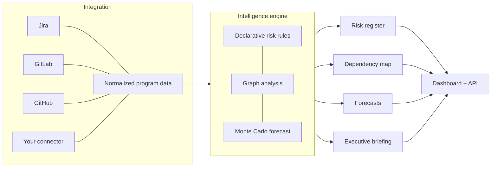

# PGM Lens

Open-source **program intelligence**: connect your delivery tools, and get straight answers to
*"When will it finish?"* and *"What needs attention?"* — with the maths shown, not hidden.

PGM Lens normalizes data from trackers (Jira, GitLab, GitHub, …) into one model, then runs four engines on it:



## Try it in 60 seconds

```bash
make setup      # uv sync + npm install
make demo       # build the dashboard and serve it with a demo program on :8000
```

Or with Docker: `docker compose up` → http://localhost:8080

## What's in the box

| Path | What it is |
|---|---|
| `packages/core` | Data model, graph analysis, forecasting, risk rules, `pgmlens` CLI |
| `packages/connectors` | Jira, GitLab and GitHub connectors, plus a base class and entry-point plugin hook |
| `packages/reporting` | Executive briefings; an LLM may only cite facts, and the output is verified |
| `apps/api` | FastAPI service |
| `apps/web` | React dashboard |
| `rules/` | Examples of custom risk rules (YAML) |

## Design principles

- **Answers first.** Every screen opens with a plain-language verdict.
- **Show the uncertainty.** Forecasts are probability bands (P50/P80/P95), not one date.
- **LLMs explain; they don't invent.** Briefings are built from numbered facts. Any claim that
  cites no fact, or contains a number or issue key not in the cited facts, is rejected and the
  deterministic briefing is used instead.
- **Rules are data.** Risk thresholds live in YAML you can extend.

## CLI

```bash
uv run pgmlens demo > demo.json
uv run pgmlens analyze demo.json --fail-on high   # non-zero exit for CI gates
uv run pgmlens brief demo.json
uv run pgmlens schema > schema.json
```

## Status and limitations (v0.1)

Be aware before relying on it:

- Storage is in memory with JSON persistence — no database yet.
- The API has no connector-sync endpoint on purpose (it would be an SSRF risk). Run connectors
  from the CLI or your own job and `POST` the resulting dataset to `/api/programs`.
- Forecasts count issues, not story points, and need a few weeks of history.
- Authentication is a single bearer token for write endpoints.

See [ROADMAP.md](ROADMAP.md).

## Contributing

Website: [pgmlens.com](https://pgmlens.com) · See [CONTRIBUTING.md](CONTRIBUTING.md) · Licensed under Apache-2.0.
